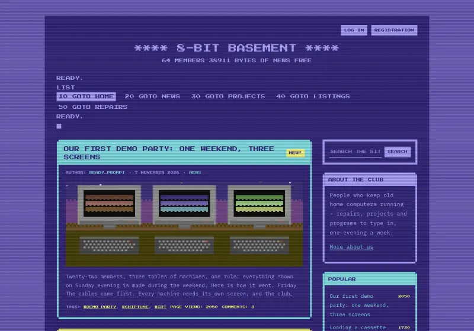
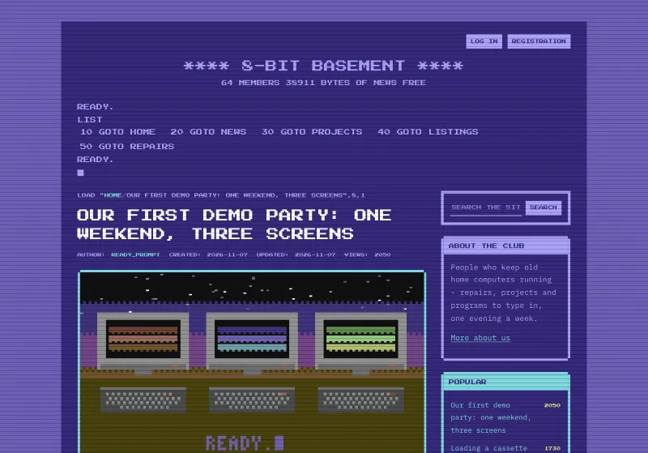
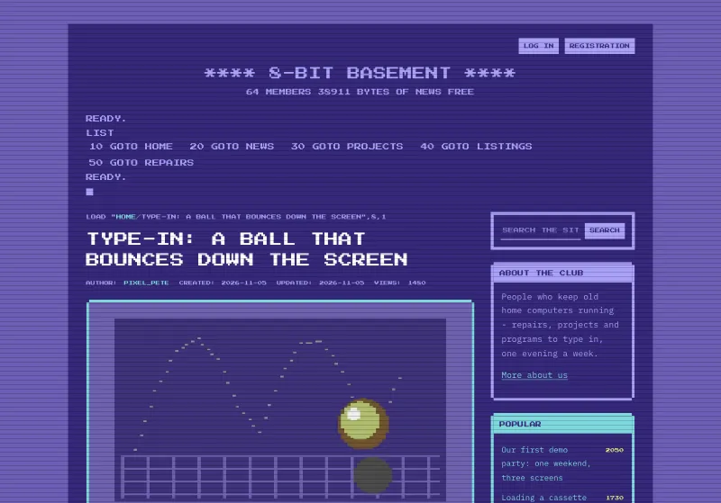
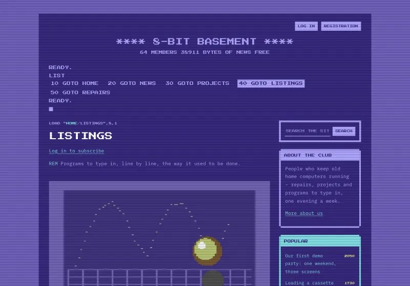
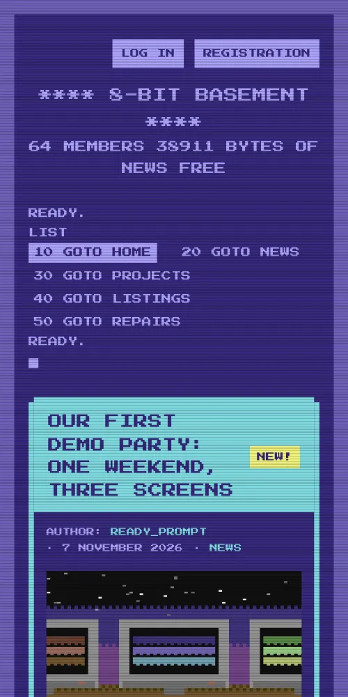
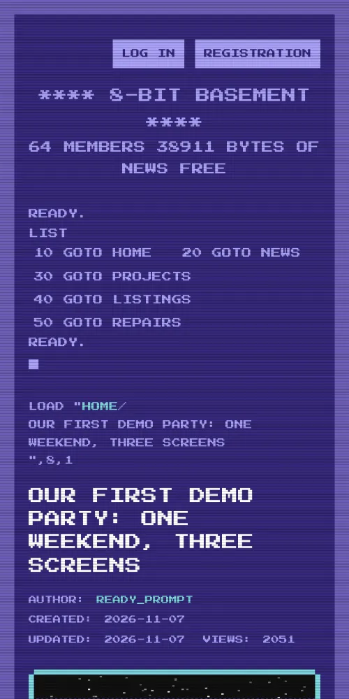

# C64

A theme for [Kosatka](https://github.com/kosatka-cms/kosatka): the
Commodore 64's screen - the boot message, the main menu as a BASIC
listing (or a disk's directory), PETSCII frames in the machine's sixteen
colours, a blinking cursor and scanlines.


## Screenshots

The [demo site](#a-demo-site); a picture opens the whole page.

<table>
  <tr>
    <td width="50%"><a href="docs/screenshots/home.webp"></a><br>The front page: the posts as cards in the machine's colours, the newest marked NEW!</td>
    <td width="50%"><a href="docs/screenshots/post.webp"></a><br>A post</td>
  </tr>
  <tr>
    <td><a href="docs/screenshots/listing.webp"></a><br>A listing to type in</td>
    <td><a href="docs/screenshots/section.webp"></a><br>A term's page</td>
  </tr>
  <tr>
    <td><a href="docs/screenshots/phone-home.webp"></a> <a href="docs/screenshots/phone-post.webp"></a><br>On a phone: the front page, a post</td>
    <td></td>
  </tr>
</table>

## Install

Kosatka 0.1.7 or newer.

```bash
app theme add https://github.com/kosatka-cms/kosatka-theme-c64
```

Then commit `themes/` and choose *C64* on *Appearance*. See
[Distributing a theme](https://kosatka-cms.github.io/kosatka/themes/distribute/).

More themes for Kosatka: the [themes catalog](https://github.com/kosatka-cms/themes).

## A demo site

The theme comes with a demo site in English (`demo/en.yaml`): "8-Bit
Basement", a club of people who keep old home computers running -
repairs, projects, programs to type in and the club's news, with
comments, sections and tags. Everything in it is made up - the club, the
people and the posts; its pictures are drawn for it as the machine's
graphics, wide pixels in its sixteen colours, and come with the theme
(`demo/images`). The listings are in a text format of the demo's own,
*HTML with listings*, which keeps them when a post is edited. On a new
site:

```bash
app install -site-name "8-Bit Basement" -admin-name admin -admin-email admin@example.com \
  -language en -demo-set c64
```

Everything the demo creates is ordinary content, Views and blocks,
changed or deleted in the admin.

The screenshots above are of it: `python3 scripts/screenshots.py
http://127.0.0.1:8080` (the demo site's address) takes them again into
`docs/screenshots/` - Python 3 and Google Chrome are all it needs.

## Settings

On *Appearance → C64 → Settings*:

| Setting | Default |
|---|---|
| Screen colour | `#352879` |
| Border colour | `#6c5eb5` |
| Text colour | `#a9a1f7` |
| Main menu - a BASIC listing or a disk's directory | a listing |
| Blinking cursor | on |
| Scanlines | on |
| The machine's line under the boot message (when the site has no slogan) | `64K RAM SYSTEM  38911 BASIC BYTES FREE` |

## Regions

The engine's regions - *Main menu* (the header, under the boot message),
*Sidebar*, *Content top*, *Content bottom*, *Inside content*, *Footer*,
*Footer bottom line* - so blocks placed for another theme stay where
they are. A new site gets the copyright block and a "Powered by Kosatka
CMS" block in *Footer bottom line*; both are ordinary blocks to change
or remove on *Blocks*.

## Fonts

Press Start 2P - the machine's characters - for headings, menus,
buttons and labels, IBM Plex Mono for the text, both with Latin and
Cyrillic. They come with the theme (`static/fonts`, SIL Open Font
License 1.1) and the site serves them: no requests to other servers.

## Translations

The theme's own strings: English, Russian, German and Spanish
(`translations/`).

## License

MIT
