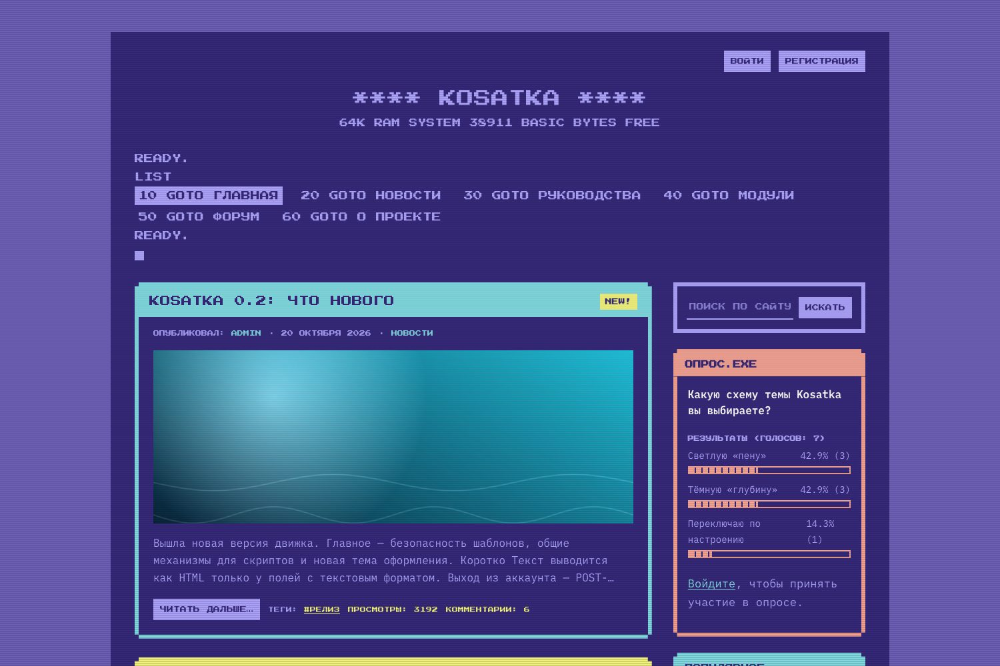

# C64

A theme for [Kosatka](https://github.com/kosatka-cms/kosatka): the
Commodore 64's screen - the boot message, the main menu as a BASIC
listing (or a disk's directory), PETSCII frames in the machine's sixteen
colours, a blinking cursor and scanlines.



## Install

```bash
app theme add https://github.com/kosatka-cms/kosatka-theme-c64
```

Then commit `themes/` and choose *C64* on *Appearance*. See
[Distributing a theme](https://kosatka-cms.github.io/kosatka/themes/distribute/).

## Settings

On *Appearance → C64 → Settings*:

| Setting | Default |
|---|---|
| Screen colour | `#352879` |
| Border colour | `#6c5eb5` |
| Text colour | `#a9a1f7` |
| Main menu - a BASIC listing or a disk's directory | a listing |
| Blinking cursor | on |
| Scanlines | on |
| The machine's line under the boot message (when the site has no slogan) | `64K RAM SYSTEM  38911 BASIC BYTES FREE` |

## Regions

The engine's regions - *Main menu* (the header, under the boot message),
*Sidebar*, *Content top*, *Content bottom*, *Inside content*, *Footer*,
*Footer bottom line* - so blocks placed for another theme stay where
they are. A new site gets the copyright block in *Footer bottom line*.

## Translations

The theme's own strings: English, Russian, German and Spanish
(`translations/`).

## License

MIT
